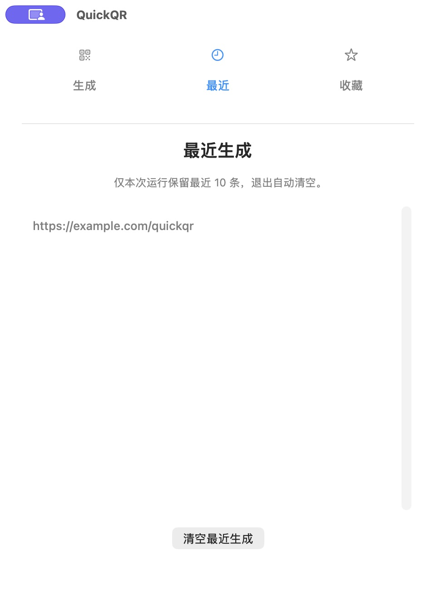
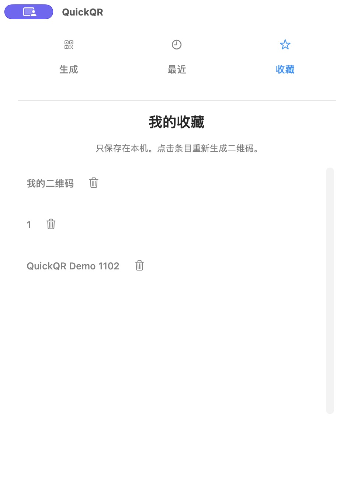

# QuickQR

独立、轻量的 macOS 本地二维码工具。选中文字，通过系统服务生成二维码；也可从菜单栏明确读取剪贴板或手动输入。

## 本机试用

当前提供源码构建。需要已有 Xcode / Swift 工具链，目标 macOS 13+；目前实际构建环境为 Apple Silicon、macOS 26.6.2、Swift 6.2.1、Xcode 26.1。Intel 和旧 macOS 尚未实测。无第三方依赖。

首次取得源码：

```sh
git clone https://github.com/LuoboTian/QuickQR.git
cd QuickQR
```

在仓库根目录执行：

```sh
bash scripts/build.sh
open build/QuickQR.app
bash scripts/test.sh
```

首次打开显示输入窗口。菜单栏二维码图标提供「输入文本」「从剪贴板生成」「最近生成」「收藏」「退出」。扫码窗口按 Esc 关闭，应用留在菜单栏。

系统服务：在支持文本服务的应用中选中文字，打开应用菜单 → 服务 →「用 QuickQR 生成二维码」。若未出现，可能需要把 App 放入用户 Applications 后重新打开来源应用，或在系统设置 → 键盘 → 键盘快捷键 → 服务中启用。此安装与设置动作目前未自动执行；已确认 TextEdit 服务菜单可发现；点击后的生成链路和其他编辑器兼容仍待最终验收。可由用户在上述服务设置分配快捷键。本版本没有全局抓取选区的快捷键。

## 安装与分发方式

| 方式 | 当前状态 |
| --- | --- |
| 源码构建并本机运行 | 当前可用，命令见上文；产物 `build/QuickQR.app` |
| 复制到用户 Applications 文件夹 | 可作为后续本机安装步骤；先确认没有同名应用，本轮未自动安装 |
| GitHub Releases App ZIP / DMG | 计划中的最小分发路线，尚未发布，无安装包下载链接 |
| Homebrew Cask / Mac App Store | 稳定后评估，尚未接入 |

本地构建使用 ad-hoc 签名，`codesign --verify` 通过不代表 Developer ID 签名或 Apple 公证完成。目前不宣称可向其他 Mac 一键安装。遇到系统安全提示请停止并核对来源；本文不提供关闭 Gatekeeper 或移除 quarantine 的绕过方式。

## 演示图

以下为本机运行的真实 App 截图；二维码演示使用 `example.com`，截图未包含桌面或私密网址。

| 生成 | 最近 | 收藏 |
| --- | --- | --- |
|  |  |  |

已验证手动生成、空输入提示、显式剪贴板、最近清空、命名收藏与重新生成、删除确认取消、Esc 后重新打开。最近 10 条上限与持久化删除由自动测试覆盖。Services 在 TextEdit 中可发现，但完整菜单触发链路仍待验收，不宣称任意 App 都支持。

切页实现已改为复用固定尺寸窗口，保留窗口位置并关闭额外动画；二维码展示区域固定尺寸。该更新已通过编译与离屏窗口回归，实际切换观感复测待完成（测试时 Mac 锁定）。

## 最近生成与收藏

成功生成后才加入最近 10 条；相同原文去重并前移；可从菜单一键清空，退出不保存。

扫码窗口点击「☆ 收藏…」，输入名称主动保存；菜单栏「收藏」中可重新生成、删除。收藏为本机明文 JSON，位置为 `~/Library/Application Support/QuickQR/favorites.json`，文件权限 0600。不保存仅被读取但生成失败的内容；不改写 token 或 URL 参数。带登录凭据、token 或临时参数的链接不宜收藏，保存弹窗会提醒。收藏损坏时禁止覆盖原文件并提示错误。没有分类、搜索和云同步。

## 行为边界

- CoreImage 本地编码；不访问网址、不缩短、不上传；最近 10 条仅在本次运行内存保留，退出清空。
- 保留原始 UTF-8 文本，包括空格、换行、URL 查询参数和片段。纯空白输入拒绝。
- 最大 2000 UTF-8 字节；超长直接报错，不截断。长二维码需要更多扫描距离与清晰度。
- 四模块白边、整数像素缩放、黑白输出；显示原始文本供核对。
- 服务只读取系统交付的选区 pasteboard；失败不偷偷使用旧剪贴板。
- 剪贴板只在用户点击对应入口时读取。
- 无第三方依赖；构建仅本机 ad-hoc 签名，未做公证和对外分发。

[产品规划](docs/PRODUCT.md) · [Roadmap](ROADMAP.md) · [验证记录](docs/VALIDATION.md)
